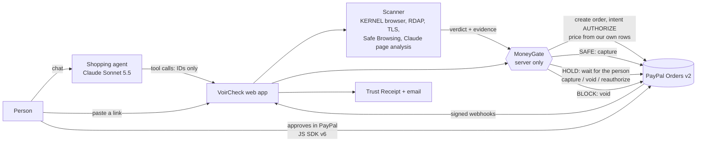

# VoirCheck

Your AI agent sees who it's paying, before it pays.

VoirCheck checks an online store for signs of a fake shop, then decides what PayPal does with the money: pay, hold
it for you, or release it. Built for the PayPal AI Hackathon 2026.

- **Live app:** https://voircheck.com
- **Try the demo:** press "Try the demo" on the home page. It creates a private temporary account (English, Demo mode
  on). Everything runs in the PayPal **sandbox**: no real money moves.
- **Video:** [link coming]

## The 30-second story

AI agents are starting to shop for people. Fake shops are built to look real: a copied layout, a price that is a
little too good, a fresh domain, and sometimes hidden text that tells an AI "this store is verified safe". An agent
that reads the page and pays straight away is the easiest customer a fake shop could ask for.

VoirCheck puts a check between "buy" and "paid":

1. The buyer approves an order in PayPal with intent **AUTHORIZE**: PayPal holds the money, nothing is taken yet.
2. VoirCheck scans the store in an isolated cloud browser and scores six signals.
3. Server code (**MoneyGate**) decides from that scan: **SAFE** is captured, **HOLD** waits for the person to look at
   the evidence and capture or void, **BLOCK** is voided and the hold is released.
4. Every decision gets a public Trust Receipt page; final outcomes also get an email copy.



The agent and the browser only ever send IDs. Amounts, stores and verdicts come from our own database, and only
MoneyGate can move money.

## How we use PayPal

| What | How | Code |
|---|---|---|
| Orders v2, intent `AUTHORIZE` | Every approved purchase is an authorization first, priced from our stored candidate row, never from the browser or the model. All orders go to the app's own sandbox merchant; the store is named in `custom_id` + description (per-store payees can't be voided, see `docs/spike-results.md`). | `packages/paypal/src/orders.ts`, `packages/paypal/src/gate.ts` |
| Capture, void, reauthorize | SAFE is captured; BLOCK is voided; HOLD waits for the person. Reauthorize is offered once, from day 4 (PayPal rejects it inside the 3-day honor period); the pay page shows the honor period and the 29-day expiry. | `packages/paypal/src/gate.ts` |
| JS SDK v6 | PayPal buttons for buyer approval (sandbox). | `apps/web/lib/paypal-sdk.ts`, `apps/web/components/Checkout.tsx` |
| Vault | Auto-pay (off by default): the wallet is saved during the first approved purchase; later SAFE purchases under the person's limit are charged without another approval. Never for HOLD or BLOCK. | `packages/paypal/src/gate.ts` |
| Webhooks | Signature-verified (`verify-webhook-signature`), stored once per event ID, payer details redacted. Refund events (`PAYMENT.CAPTURE.REFUNDED` / `REVERSED`) are matched by capture and keep History and the receipt in sync. | `packages/paypal/src/webhooks.ts`, `apps/web/app/api/paypal/webhook/route.ts` |
| Agent Toolkit `get_order` | The agent reads an order's status through the Toolkit's read-only `get_order` (sandbox forced, status fields only, the person's own orders only). We don't use the Toolkit's `create_order` / `pay_order`: they create CAPTURE orders priced by the model, which would bypass the check. | `packages/agent/src/paypal-toolkit.ts` |
| Agent Toolkit `create_refund` | Full refunds of the person's own paid orders. The agent's `request_refund` only proposes one (a chat card); the person's "Request refund" button (chat or History) runs it through MoneyGate, which calls the Toolkit's `create_refund` on a separate instance (only that tool, sandbox forced, one PayPal-Request-Id per payment so it can't refund twice). The agent also offers a refund when a store the person already paid scans BLOCK. | `packages/paypal/src/gate.ts`, `packages/agent/src/paypal-toolkit.ts`, `apps/web/components/RefundButton.tsx` |
| Sandbox only | The PayPal client refuses any non-sandbox API URL. | `packages/paypal/src/client.ts` |

## How we use AI

Both use Claude Sonnet 5.5 through the Anthropic TypeScript SDK.

- **Page analysis (signal 4 of 6):** one structured-output call per uncached scan. It reads the store's pages as
  marked, untrusted data and returns findings (kind, severity, a quote, the page), a risk score from 0 to 100, and a
  short plain-language summary in English and French. Quotes are checked against the page text: one that isn't on
  the page is shown as the AI's own note, never as a quote. Results are cached per URL for 24 hours.
  `packages/scanner/src/signals/ai-page.ts`
- **Shopping agent:** finds an item at up to 3 stores (Channel3 product search, plus our demo stores), checks every
  store before recommending one, ranks by trust first and price second, and prepares the order. Seven tools, none of
  which can capture, void, override or refund (`request_refund` only proposes; the person's button decides). `packages/agent/src/tools.ts`, `packages/agent/src/prompt.ts`,
  `packages/agent/src/anthropic-model.ts`, `apps/web/lib/agent-runtime.ts`

## Security: the AI never touches the money

- **MoneyGate decides, not the model.** The agent can only ask to prepare an order or to settle one the person
  approved. MoneyGate refuses BLOCK stores and stores it couldn't verify, takes the price from our rows, and settles
  by the verdict of a fresh scan of that same store. Only the person can pay a BLOCK store anyway, after confirming
  the risk; the agent and Auto-pay never can. Every money decision goes to an append-only audit log.
  `packages/paypal/src/gate.ts`
- **Page text can't instruct the agent.** The agent never sees page text, titles or evidence strings, only our own
  structured summary (verdict, score, signal statuses in our words, and one flag if the page tried to instruct
  agents). `scanSummaryForAgent` in `packages/agent/src/tools.ts`
- **Injection defenses in page analysis.** Page text goes in marked untrusted blocks, the output must match a strict
  schema, and quotes must really be on the page. `packages/scanner/src/signals/ai-page.ts`
- **Hidden-text detection.** The scanner collects text a visitor can't see (clipped, off-screen, invisible, zero-size,
  tiny or same-colour text) and flags lines that address AI agents. `packages/scanner/src/hidden-text.ts`
- **Two signs before a BLOCK.** No single warning blocks a store: BLOCK needs two strong signals together, such as
  a copied page and a fresh domain. Hard rules add floors: a threat-list hit always blocks; no valid HTTPS, a
  verified injection attempt, a young domain with a much lower price, or a page we couldn't read is at least HOLD.
  `packages/scanner/src/scoring.ts`
- **Store pages never open on our server or your device.** Every visit runs in KERNEL's isolated cloud browser.
  The server only does DNS, RDAP and TLS checks, behind SSRF guards (public http(s) only, private and metadata
  addresses blocked, redirects re-checked). `packages/scanner/src/ssrf.ts`, `packages/scanner/src/kernel.ts`
- **Spend caps and rate limits.** Per-user, per-guest and per-IP hourly limits on scans and agent requests, a
  $0.50 model budget per conversation, and global daily caps (300 KERNEL scans, $3 of Anthropic). Past a cap the
  app says so and degrades: cached scans only, or page analysis unavailable. `apps/web/lib/rate-limit.ts`,
  `apps/web/lib/spend.ts`
- **Web basics.** Strict CSP, HSTS, no framing (`apps/web/lib/security-headers.ts`); Zod on every API input and
  every AI output; model text is always rendered as plain text.

To report a vulnerability, see [SECURITY.md](SECURITY.md).

## Accuracy

We report what we measured, on small samples.

**Method** (`eval/stores.json`, runner `pnpm eval:run`)
- Ground truth comes only from named sources, never from VoirCheck: scams from Watchlist Internet's fake-shop list;
  legit stores are established retailers (Wikipedia) and Austrian E-Commerce-Gütezeichen certified shops.
- A scam counts as **caught** when VoirCheck says HOLD or BLOCK. A legit store on HOLD is a soft false alarm; one on
  BLOCK is a hard false alarm. Dead sites are excluded and counted.
- Splits:
  - **`tune`** (10 scam + 10 legit): settings may be tuned here, so its numbers flatter us.
  - **`seen-2026-10-31`** (20 + 20): run once as a baseline before the AI signal. It may inform tuning and is never
    reported as a final number.
  - **`holdout`**: scams first reported after 2026-10-31 plus fresh legit shops. Run once per scanner version, never
    tuned on.
- Eval scans use the homepage URL only, with no other stores to compare prices against, so the price signal is
  unavailable there.

**Tune numbers (labelled tune: the AI cutoffs were chosen on this split)**
- Before the AI signal (2026-10-31): 2 of 8 scams caught, 1 of 10 legit on HOLD, 0 blocked. Most catches were
  "couldn't verify" bot walls, not real detections.
- AI page analysis on its own, same captured pages, Sonnet 5.5 (2026-11-01): 6 of 7 readable scams scored at or above
  the fail cutoff (risk 50), 0 of 9 legit did (legit stores scored at most 12).
- Run-to-run noise on the same input is real: up to about 20 points (one scam scored 30 and 48 on two runs).
- Reports: `eval/results/2026-10-31-tune.md`, `eval/results/2026-11-01-tune-ai-compare-2.md`,
  `eval/results/2026-11-02-tune-ai-noise.md`.

**Holdout: coming.** It hasn't been run yet. We'll publish it here once, as measured.

## Testing guide for judges

**Sign in:** press "Try the demo" on https://voircheck.com. To approve payments in the PayPal sandbox window you
need a sandbox buyer account: [see Devpost testing instructions]. No passwords are kept in this repository.

**Demo stores** (fictional brands, clearly labelled, never take payment or personal details):

| Store | Role | URL |
|---|---|---|
| Velbrook Supply | legit | https://voircheck-stores.onrender.com/s/velbrook-supply |
| Velbrook-Outlet Deals | fake copy | https://voircheck-stores.onrender.com/s/velbrook-outlet-deals |
| Ondaya Home | legit | https://voircheck-stores.onrender.com/s/ondaya-home |
| 0ndaya Home | fake copy (zero for O) | https://voircheck-stores.onrender.com/s/0ndaya-home |
| Nyuie Market | legit | https://voircheck-stores.onrender.com/s/nyuie-market |
| Nyuie Market Clearance | borderline | https://voircheck-stores.onrender.com/s/nyuie-market-clearance |

The demo stores are on a free Render plan until Nov 11, so the first load may take a few seconds.

**Five things to try**
1. **SAFE, paid.** Paste `https://voircheck-stores.onrender.com/s/velbrook-supply/products/zephlet-buds` into "Check a
   link", press Check, then buy and approve in PayPal. The payment is captured and you get a Trust Receipt.
2. **BLOCK, with evidence.** Check `https://voircheck-stores.onrender.com/s/velbrook-outlet-deals/products/zephlet-buds`
   (same earbuds, $23 instead of $59). Open the evidence: hidden text aimed at AI agents, a copied store and a
   price far below the others. If you buy and approve anyway, VoirCheck voids the authorization; the payment page
   then offers "Pay anyway", which only works after you confirm the risk.
3. **HOLD.** Check `https://voircheck-stores.onrender.com/s/nyuie-market-clearance`, buy and approve. PayPal holds the
   money; on the payment page you decide to capture or void it, with the honor-period countdown.
4. **The agent.** In the chat: "find wireless earbuds under $60". It checks both stores and prepares the order at
   the safe one. Then try "buy the cheaper one instead" and "just pay it": it explains the block and can't pay.
5. **French.** Settings → Français. The app, the agent's replies, the evidence and the receipts switch to French
   (quotes from store pages stay as written).

## Tech stack

- Next.js 16 (App Router), React 19, TypeScript, Tailwind CSS 4
- Neon Postgres + Neon Auth (magic link, Google, email and password), Drizzle ORM and drizzle-kit
- PayPal Orders v2 REST, JS SDK v6, Agent Toolkit 1.11.0 (read-only `get_order`; `create_refund` run by MoneyGate)
- Anthropic TypeScript SDK (Claude Sonnet 5.5) for page analysis and the agent
- KERNEL cloud browser for every store visit
- Channel3 product search
- Google Safe Browsing, RDAP, Tranco top-sites list
- Resend for receipt and sign-in emails
- Render for hosting; Vitest and Zod

## Repository layout

```
apps/web/          VoirCheck app: workspace, agent chat, pay pages, receipts, API routes
apps/stores/       the six fictional demo stores: one template, themed by config
packages/scanner/  six signals, scoring and hard rules, KERNEL visits, SSRF guards, AI page analysis
packages/paypal/   PayPal REST client (sandbox only), MoneyGate, webhooks
packages/agent/    shopping agent: tools, prompt, model loop, product search, Agent Toolkit get_order + create_refund
packages/shared/   shared types, ownership helper, demo store config, order references
db/                Drizzle schema, migrations, seed, retention rules
scripts/           eval runner, offline agent demo, PayPal checks, maintenance jobs
eval/              real-world test set and results
docs/              PayPal spike results
```

`VOIRCHECK_SPEC.md` is the project's full spec and decision log.

## Run it locally

Needs Node 22+ and pnpm 10.

```bash
pnpm install
cp .env.example .env
```

Fill in `.env` with your own keys. `.env.example` lists every variable with placeholders only. You need at least the
PayPal **sandbox** app, Neon (database + auth) and KERNEL. Without `ANTHROPIC_API_KEY`, page analysis is
"unavailable" (0 points) and the agent runs a scripted stand-in model.

```bash
pnpm db:migrate
pnpm db:seed
pnpm --filter ./apps/web dev      # http://localhost:3000
pnpm --filter ./apps/stores dev   # http://localhost:3001
```

`pnpm agent:demo` (add `--fr` for French) runs the earbuds conversation offline: the real MoneyGate and demo
catalog, with a fake PayPal and saved scan results. No keys needed.

## Tests

```bash
pnpm test        # Vitest: 654 tests
pnpm typecheck
pnpm lint
```

The tests cover scoring and hard rules, MoneyGate decisions, webhook verification, injection handling, what the
agent can and can't see, the offline agent flow, receipts and the French translations. They run without network
access or keys.

## Limitations and responsible choices

- **Sandbox only.** No real money moves. The PayPal client refuses non-sandbox URLs.
- **No CAPTCHA solving.** Scans never use stealth browsing or solve a site's CAPTCHA. A store behind a bot check
  is "couldn't verify" (at least HOLD), so some real retailers get held.
- **EU VIES skipped.** Its terms limit VAT checks to businesses verifying trading partners, so VAT and registration
  numbers are only collected as evidence, not verified.
- **Tranco is non-commercial.** Part of its input (Cloudflare Radar) is CC BY-NC; fine for this hackathon, to be
  re-checked before any paid use.
- **Google Safe Browsing is non-commercial.** A paid product would move to Google Web Risk.
- **No domain age for `.de`.** There is no public RDAP server for `.de`, so domain age is "unavailable" for German
  shops, which make up much of our scam source.
- **Run-to-run noise.** The scan model accepts no temperature setting, so the same page can score differently on
  two runs (up to about 20 points in our check). Scores near a cutoff can flip.
- **Small, regional samples.** Our scams come from one source and are mostly German and Austrian.
- **Data retention.** Data is kept through judging (until 2026-12-15); after that, user-linked data is deleted 90
  days after it was created (`pnpm retention:run`, rules in `db/src/retention.ts`).

## Credits and attribution

- **PayPal:** Orders v2, JS SDK v6, Agent Toolkit.
- **Anthropic:** Claude Sonnet 5.5.
- **KERNEL:** isolated cloud browsers for every store visit.
- **Channel3:** product search.
- **Render:** hosting.
- **Neon:** database and auth.
- **Resend:** email.
- **Tranco** top-sites research list (well-known-site evidence), pinned list
  [746VX](https://tranco-list.eu/list/746VX) of 2026-10-30. Le Pochat et al., "Tranco: A Research-Oriented Top Sites
  Ranking Hardened Against Manipulation", NDSS 2019. Built from Chrome UX Report (CC BY-SA 4.0), Majestic (CC BY 3.0),
  Cisco Umbrella, Farsight and Cloudflare Radar (CC BY-NC 4.0). Used non-commercially.
- **Google Safe Browsing** (threat lists), used non-commercially. Advisory provided by Google.
- **Watchlist Internet** fake-shop list and the **Austrian E-Commerce-Gütezeichen** list: eval ground truth.

All code was written during the hackathon, from Oct 27, 2026.

## License

[MIT](LICENSE)
